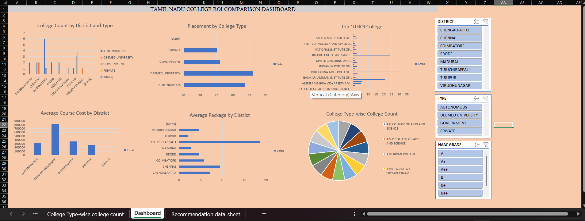
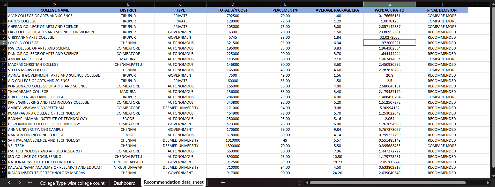

# tamil-nadu-college-roi-dashboard
Excel dashboard for comparing Tamil Nadu college based on fees,placements and average packages.

📊 Self-Initiated Data Analytics Project | Tamil Nadu Colleges ROI Comparison Dashboard using Microsoft Excel

🎓 Project Overview

Choosing the right college is an important decision for students and parents. Comparing college fees, placement percentages, average salary packages, and other factors can help students make informed decisions.

To explore this real-world problem, I developed a Tamil Nadu Colleges ROI Comparison Dashboard using Microsoft Excel.

📂 Data Collection

I manually collected real-world college-related data from online sources and organized it in Excel for analysis. I then cleaned, structured, and analyzed the collected data to build an interactive dashboard and college recommendation sheet.

🎯 Project Objectives

* Compare college fees and total course costs.
* Analyze placement percentages and average salary packages.
* Compare colleges across districts and college types.
* Support college comparison and decision-making.

🛠️ Tools & Skills Used

* Microsoft Excel
* Manual Data Collection and Data Cleaning
* Data Analysis using Excel Formulas
* PivotTables and Pivot Charts
* Interactive Slicers
* Dashboard Design and Data Visualization

📈 Key Project Features

1. Interactive Dashboard

* Visualized college data using charts and PivotTables.
* Added interactive slicers for District, College Type, and NAAC Grade.
* Compared college fees, placement percentages, and average packages.

2. Final Recommendation Sheet

* Summarized important college details in a separate sheet.
* Included total course cost, placement percentage, average package, and payback ratio.
* Classified colleges as **“Recommended”** or **“Compare More”** based on the available data.

💡 Key Learning Outcomes

This project improved my skills in manual data collection, data cleaning, Excel analysis, dashboard creation, and data-driven decision-making.

🚀 Disclaimer 

This is a self-initiated portfolio project that helped me apply my Excel skills to a real-world problem.

## Dashboard Preview

## Final Recommendation Preview

